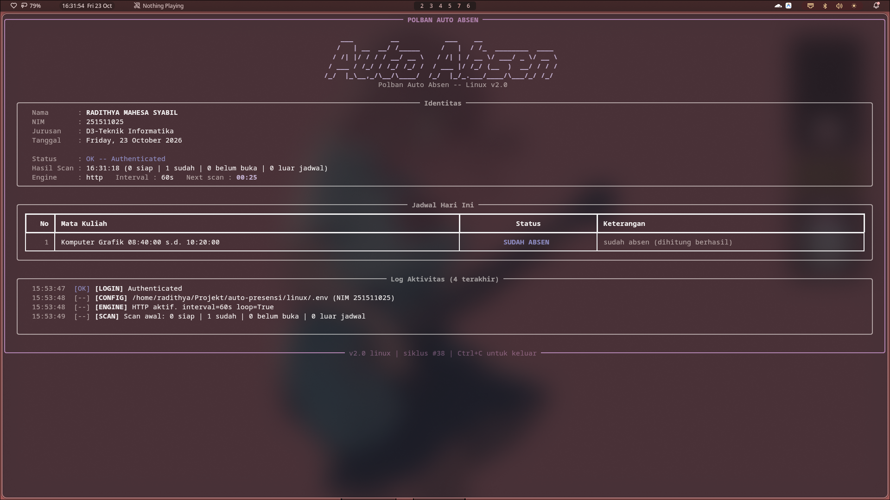

# Polban Auto Absen untuk Linux (Terminal TUI)

Auto-login + auto-klik tombol absen **biru** di `akademik.polban.ac.id/ajar/absen` menggunakan binary native Rust (`polban-absen`) dengan **live terminal dashboard** (`ratatui`).

---

## Tampilan

<p align="center">
  
</p>

Dashboard berjalan di **alternate terminal buffer** (seperti `htop`), mendukung scroll (`↑`/`↓`, `PgUp`/`PgDn`, `Home`/`End`, `j`/`k`/`g`/`G`/spasi/`b`), dan responsif terhadap lebar terminal (4 tingkat kolom tabel jadwal).

---

## Quick Start

```bash
cd linux

# 1. Unduh release binary (CLI static musl + Desktop GUI) atau build via Cargo + siapkan .env
bash install.sh
# Opsional: tambahkan --desktop untuk membuat shortcut ~/.local/share/applications/polban-presensi.desktop
# bash install.sh --desktop

# 2A. Jalankan Aplikasi Desktop Polban Presensi (GUI)
bash run-gui.sh

# 2B. Atau mode CLI/TUI: edit .env lalu jalankan
nano .env
bash run.sh --once
bash run.sh
```

---

## Argumen CLI

| Argumen | Keterangan |
| --- | --- |
| `--engine http` | Engine HTTP ringan (default; satu-satunya engine di v3.0) |
| `--once` | Sekali jalan lalu exit (tanpa alternate screen; cocok untuk cron jika digabung `--plain`) |
| `--plain` | Paksa mode plain text (tanpa live TUI) |
| `--no-alt-screen` | Gambar dashboard di layar biasa (tanpa alternate screen) |
| `--ascii` | Pakai box border ASCII (`+ - |`) |
| `--dump [FILE]` | Simpan HTML halaman absen ke file lalu exit (diagnostik) |

---

## File

| File | Fungsi |
| --- | --- |
| `polban-absen` | Binary Rust CLI/TUI (diunduh/dibangun oleh `install.sh`, di-ignore git) |
| `polban-absen-gui` | Binary Rust Desktop GUI **Polban Presensi** (diunduh/dibangun oleh `install.sh`, di-ignore git) |
| `install.sh` | Unduh binary release CLI + GUI atau build via `cargo build --release`, plus opsi `.desktop` |
| `run.sh` | Launcher CLI/TUI (meneruskan `POLBAN_ENV` dan argumen CLI) |
| `run-gui.sh` | Launcher Desktop GUI (`polban-absen-gui`) |
| `.env.example` | Template config |

## Aplikasi Desktop (Linux)

- **Fedora (RPM, disarankan):** unduh `Polban-Presensi-Fedora-x64.rpm` dari [GitHub Releases](https://github.com/raditted/Polban-Auto-Absen-rs/releases/latest) lalu pasang lewat DNF:
  ```bash
  sudo dnf install ./Polban-Presensi-Fedora-x64.rpm
  ```
  Paket RPM memasang binary ke `/usr/bin/polban-absen-gui`, ikon, serta shortcut aplikasi **Polban Presensi** otomatis. Untuk memperbarui versi ke depannya, jalankan `sudo dnf upgrade ./Polban-Presensi-Fedora-x64.rpm`.
- Jika membangun `polban-absen-gui` dari source di Fedora, pasang paket development berikut:
  ```bash
  sudo dnf install -y gtk3-devel libayatana-appindicator-gtk3-devel \
    libxkbcommon-devel libxcb-devel mesa-libGL-devel dbus-devel
  ```
- Jika membangun `polban-absen-gui` dari source di Ubuntu/Debian, pasang paket dependensi sistem terlebih dahulu:
  ```bash
  sudo apt-get update && sudo apt-get install -y \
    libgtk-3-dev libayatana-appindicator3-dev libxdo-dev \
    libxcb-render0-dev libxcb-shape0-dev libxcb-xfixes0-dev \
    libxkbcommon-dev libgl1-mesa-dev libdbus-1-dev
  ```
- Kredensial di GUI disimpan lewat Secret Service OS (GNOME Keyring/KWallet) jika tersedia, atau memori sesi sebagai fallback.
- Jalankan `bash install.sh --desktop` untuk menambahkan **Polban Presensi** ke menu aplikasi (`~/.local/share/applications/polban-presensi.desktop`).

---

## Mode Plain / Non-TTY

Jika terminal bukan TTY (misalnya dialihkan ke file log / cron) atau memakai `--plain`:
- Otomatis berjalan dalam mode plain text tanpa overhead TUI.

## Keamanan

- Kredensial disimpan **lokal** di `.env` dan password di-redact di output debug.
- File `.clicked.json`, `polban-absen`, dan `*-dump.html` sudah ada di `.gitignore`.
